# Data model

Schema source of truth: `supabase/migrations/` (forward-only, numbered). Types in
`packages/db/src/database.types.ts` are generated from a database with the migrations applied
(`pnpm --filter @gms/db gen:types`). Seed: `supabase/seed.sql` (fictitious data only).

## Rules the schema enforces

- **UUIDv7 keys** from `gms.uuid_v7()`; `created_at` / `updated_at` on every table, kept by a trigger.
- **RLS on every table.** Workers use the service role and still filter by `workspace_id`
  (`forWorkspace` in `@gms/db`). Policies are written for a user-scoped key anyway:
  `anon` has no table access, `authenticated` has `SELECT` only, and tables that hold secrets or
  OAuth state have no policy and no grant. Every write goes through the service layer.
- **No bank or identity data.** No column can hold a routing, account or government identifier;
  the only bank-related display values are a bank name and last4 inside jsonb. No table holds a
  payout destination. `awards.funding.disbursed` is a cache of Passport's figure.
- **Status vocabularies** are SQL functions (`gms.application_statuses()` …) that mirror
  `packages/workflow/src/statuses.ts`; a unit test in `packages/db` fails when they drift.
- **Append-only ledger.** `ledger_events` and `ledger_archives` reject UPDATE, DELETE and TRUNCATE
  by grant and by trigger, including for the table owner.
- **Immutability triggers:** a published form version, a committed decision, an executed
  agreement and a resolved approval cannot be changed.

Row-level security cannot hide columns. Funder-internal columns on `applications` (`tags`,
`assigned_to_user_id`, `eligibility`), PII masking and `reviewerVisible` fields for reviewers are
enforced by the service layer; reviewers have no direct policy on `form_responses`.

## Who can read what (user-scoped key)

| Reader | Sees |
|---|---|
| Funder staff (`admin`, `program_officer`, `finance`, `observer`, `auditor`) | Everything in their workspace; applicant workspaces that consented |
| `reviewer`, `external_reviewer` | Applications assigned to them, their own assignments and reviews |
| Applicant staff (`admin`, `editor`, `finance`, `viewer`) | Their applications, awards, tranches, requirements, shared threads; funders they applied to |
| `consultant` | Applications / awards listed in `workspace_members.scope` (`applicationIds`, `awardIds`) |
| Ledger | Workspace `admin` and `auditor` only |
| Bank transactions | `admin`, `finance`, `auditor` |
| Never, for any user key | `passport_links`, `api_clients`, `oauth_*`, `custom_mcp_servers`, `webhook_*`, `inbound_events`, `invitations`, `ledger_archives`, `connector_accounts.secret_enc` |

An expired membership (`expires_at` in the past) grants nothing.

## Entity relationships

```mermaid
erDiagram
  workspaces ||--o{ workspace_members : has
  workspaces ||--o{ passport_links : "reaches Passport via"
  workspaces ||--o{ consents : "applicant grants / funder holds"
  workspaces ||--o{ programs : owns
  workspaces ||--o{ forms : "owns (null = library)"
  workspaces ||--o{ rubrics : owns
  workspaces ||--o{ templates : owns
  programs ||--o{ opportunities : funds
  opportunities ||--o{ competitions : runs
  competitions ||--o{ applications : receives
  workspaces ||--o{ applications : "applies (applicant_workspace_id)"
  applications ||--o{ form_responses : contains
  forms ||--o{ form_responses : "answered as (id, version)"
  applications ||--o{ application_events : logs
  applications ||--o{ review_assignments : "assigned to reviewers"
  rubrics ||--o{ review_assignments : "scored with (id, version)"
  review_assignments ||--o| reviews : produces
  applications ||--o{ decisions : "decided by"
  applications ||--o| awards : "becomes"
  workspaces ||--o{ awards : "receives (recipient_workspace_id)"
  awards ||--o{ awards : "parent of (supplemental)"
  awards ||--o{ agreements : "bound by"
  awards ||--|| payment_schedules : "paid per"
  payment_schedules ||--o{ tranches : contains
  awards ||--o{ requirements : owes
  requirements ||--o| tranches : "accepting releases"
  requirements ||--o{ submissions : "answered by"
  submissions ||--o{ form_responses : contains
  submissions ||--o{ submissions : "shared copy of"
  awards ||--o{ budgets : tracks
  applications ||--o{ budgets : proposes
  awards ||--o{ amendments : "changed by"
  tranches ||--o{ bank_transactions : "matched to (resolve mode)"
  requirements ||--o{ reminder_sends : reminded
  workspaces ||--o{ threads : opens
  threads ||--o{ messages : contains
  workspaces ||--o{ tasks : tracks
  workspaces ||--o{ documents : stores
  workspaces ||--o{ answers : "answer library"
  workspaces ||--o{ grantee_records : "funder notes on applicant"
  workspaces ||--o{ org_change_inbox : "Passport changes"
  workspaces ||--o{ discover_saved : "saved listings"
  workspaces ||--o{ api_clients : "API clients"
  oauth_clients_dynamic ||--o{ oauth_grants : "consented as"
  oauth_grants ||--o{ oauth_codes : issues
  oauth_grants ||--o{ oauth_refresh_tokens : rotates
  oauth_grants ||--o{ mcp_connections : backs
  workspaces ||--o{ approvals : "human gates"
  workspaces ||--o{ custom_mcp_servers : registers
  workspaces ||--o{ connector_accounts : connects
  workspaces ||--o{ webhook_subscriptions : subscribes
  webhook_subscriptions ||--o{ webhook_deliveries : delivers
  workspaces ||--o{ ledger_events : audits
  workspaces ||--o{ assist_calls : "assistant usage"
```

Not in the diagram: `invitations` (pending member invites), `inbound_events` (raw, deduped
webhooks from Passport, Resend and Mercury) and `ledger_archives` (hash-chained R2 manifest).

## Migrations

| File | Contents |
|---|---|
| `0001_init` | `gms` schema, `gms.uuid_v7()`, `gms.touch_updated_at()`, status / scope / webhook-event vocabularies |
| `0002_workspaces` | `workspaces`, `workspace_members`, `invitations`, `passport_links`, `consents` |
| `0003_programs_opportunities_forms` | `programs`, `forms`, `rubrics`, `templates`, `opportunities`, `competitions` |
| `0004_applications_reviews` | `applications`, `form_responses`, `application_events`, `review_assignments`, `reviews`, `decisions` |
| `0005_awards_payments` | `awards`, `agreements`, `payment_schedules`, `tranches`, `requirements`, `submissions`, `budgets`, `amendments`, `bank_transactions`, `reminder_sends` |
| `0006_collaboration` | `threads`, `messages`, `tasks`, `documents`, `answers`, `grantee_records`, `org_change_inbox`, `discover_saved` |
| `0007_oauth_integrations` | `api_clients`, `oauth_clients_dynamic`, `oauth_grants`, `oauth_codes`, `oauth_refresh_tokens`, `mcp_connections`, `approvals`, `custom_mcp_servers`, `connector_accounts`, `webhook_subscriptions`, `webhook_deliveries`, `inbound_events`, `assist_calls` |
| `0008_ledger` | `ledger_events`, `ledger_archives`, append-only triggers |
| `0009_rls` | RLS helper functions, RLS + grants + `updated_at` triggers on every table, policies |

A migration that adds a table must enable RLS, set its grants and add the `updated_at` trigger
itself; `supabase/tests/database/00_schema.test.sql` fails otherwise.

Additions beyond the build spec's table list: `invitations`, `oauth_refresh_tokens`,
`reminder_sends` (idempotent reminders per requirement and offset), `ledger_archives`,
`discover_saved`, `approvals`, and a denormalized funder `workspace_id` on child tables
(`form_responses`, `review_assignments`, `tranches`, …) so every service-role query can filter on it.

## API-visible ids

Rows are keyed by UUIDv7. Outside the database an id is `<prefix>_<uuid without dashes>`
(`toApiId` / `fromApiId` in `@gms/db`); `fromApiId` refuses an id of another kind.

| Prefix | Record | Table |
|---|---|---|
| `opp_` | Opportunity | `opportunities` |
| `cmp_` | Competition | `competitions` |
| `frm_` | Form (plus `?version=`) | `forms` |
| `app_` | Application | `applications` |
| `rev_` | Review | `reviews` |
| `awd_` | Award | `awards` |
| `agr_` | Agreement | `agreements` |
| `trn_` | Tranche (also the Passport `Idempotency-Key`) | `tranches` |
| `req_` | Requirement | `requirements` |
| `sub_` | Submission | `submissions` |

## Tests

- `supabase test db` runs the pgTAP files in `supabase/tests/database/`: schema invariants,
  RLS isolation across two funders and two applicants, ledger immutability.
- `pnpm exec vitest run --project db` runs without a database: id helpers, the workspace scope,
  and the checks that keep SQL vocabularies and generated types in step with the migrations.
